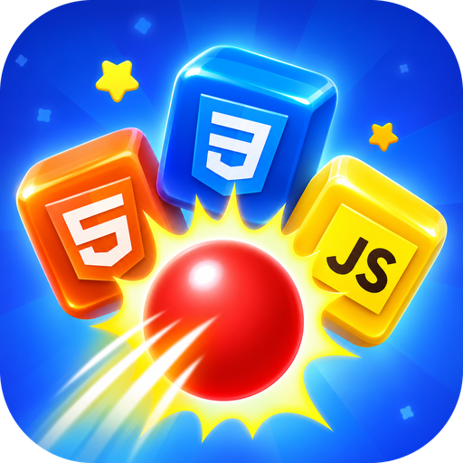
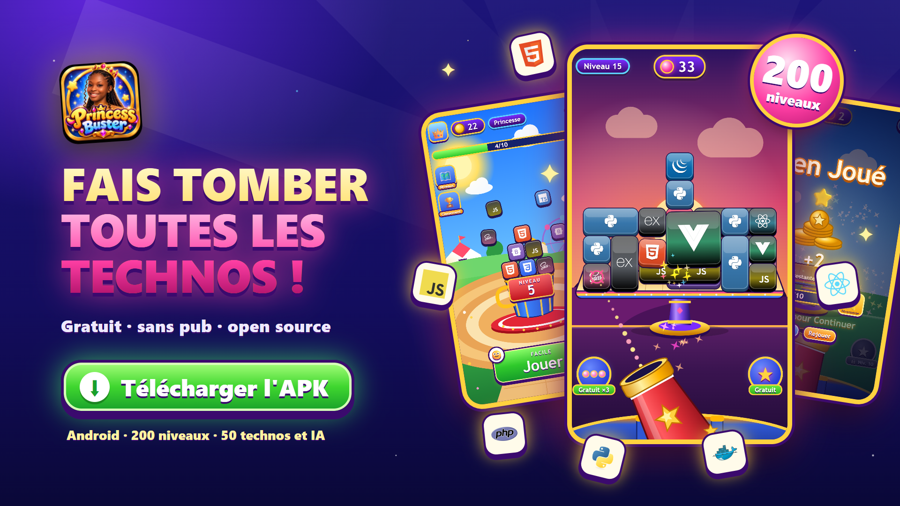
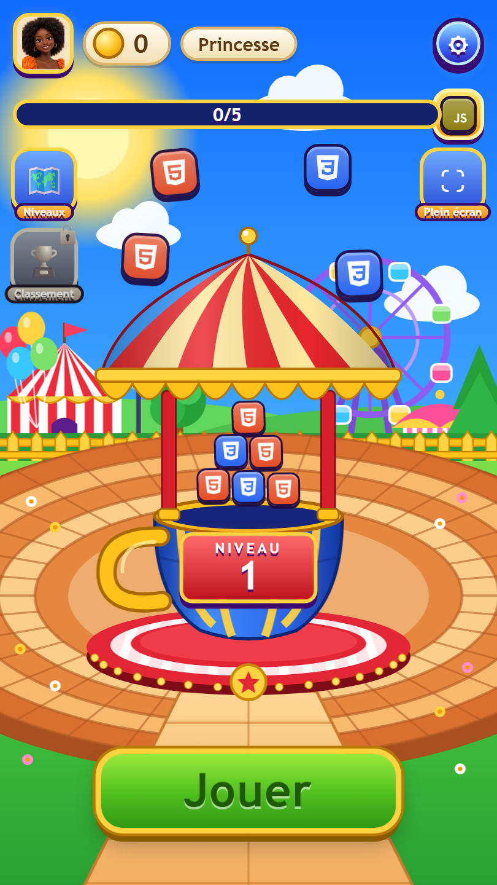
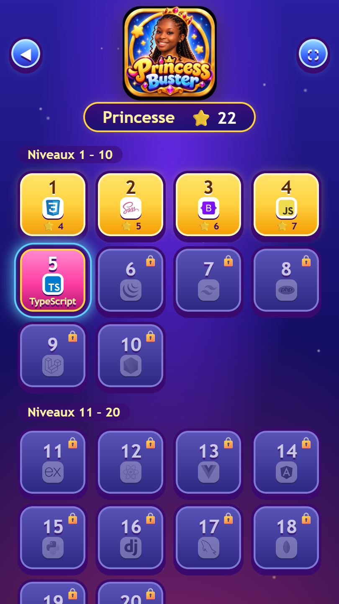
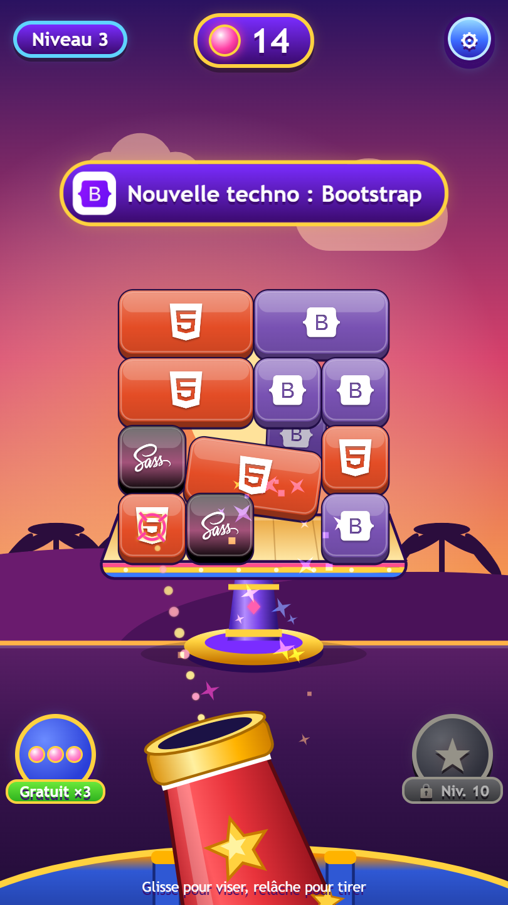
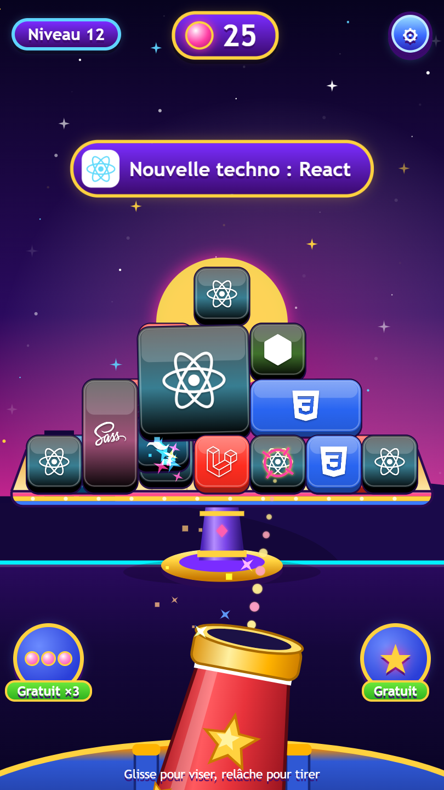

<div align="center">



# Princess Buster

**Knock down all the techs!** A 2.5D shooter where you blast stacks of programming-language and framework cubes with a limited number of balls.

[](https://github.com/princesse-aku/princess_buster/actions/workflows/ci.yml)
[](LICENSE)


[](CONTRIBUTING.md)

[Français](README.md) · [English](README.en.md)

</div>

<p align="center">
  
</p>

<p align="center">
  
  
  
  
</p>

> The game UI is currently in **French**. Translations are welcome (see the [roadmap](#roadmap)). The contribution guide is in French; feel free to open issues and PRs in English.

## The game

A stack of cubes (HTML, CSS, JavaScript, PHP, Laravel, Node.js, Docker…) sits on a table. Your cannon, fixed at the bottom of the screen, fires balls: each ball **pushes the targeted piece toward the back**. It slides along the table and **falls off behind it**.

- You **win** when no cube is left on the table. Every won level earns **20 points**, even with zero balls left (stars reward saved balls).
- You **lose** when you run out of balls while cubes remain.
- Difficulty ramps up: heavier and bigger pieces, and from level 5 on, **pieces hidden behind other pieces** (pushing the front piece knocks the one behind off first).

## Features

- 🎯 **250 levels** described in JSON files, with **50 technologies** (including AI logos: ChatGPT, Claude, Gemini, Grok, Mistral…) introduced progressively
- 🎨 **12 backgrounds** that change from level to level: meadow, night, sunset, snow, desert, ocean, candy, forest, space, autumn, volcano, neon
- 🧱 **Mixed piece shapes**: squares, wide or tall rectangles, 2×2, 3×1, 3×2
- 🌌 **Simulated depth**: depending on shot angle and impact point a piece falls **behind the table, left or right**; up to 3 hidden rows behind the front pieces
- 🔒 **No floating cubes**: every piece rests on another piece or on the table (checked by `npm test`)
- 📱 **Adaptive full screen**: phone, tablet, desktop, portrait or landscape
- 💾 **SQLite profiles and scores**: player name asked at start, best scores, progressive unlocking, leaderboard
- 🔊 Background music and SFX synthesized with WebAudio (no audio files)
- 🧩 **Zero npm dependencies**: Node.js and a browser are enough (Matter.js is bundled)

## Install and play

- ▶️ **Play online**: <https://princess-buster.vercel.app/>
- 📱 **Install as an app (PWA)**: open the game in Chrome (Android) → ⋮ menu → **Install app**; on iPhone (Safari) → Share → **Add to Home Screen**. No APK needed: it opens full screen like a native app.
- 🌐 **Browser**: [Vercel deployment](docs/DEPLOY-VERCEL.md), playable on phone, tablet and desktop.

## Quick start

Requires [Node.js](https://nodejs.org) **22.5+** (built-in `node:sqlite`).

```bash
git clone https://github.com/princesse-aku/princess_buster.git
cd princess_buster
npm start
```

Then open <http://localhost:3000>.

```bash
npm test          # validates the 250 levels
npm run levels    # regenerates levels (overwrites public/levels)
```

## Controls

| Action | Mouse / touch | Keyboard |
| --- | --- | --- |
| Aim | Drag (the reticle follows your finger) | `←` `→` (or `A` `D`) |
| Fire | Release | `Space` / `Enter` |
| Cancel a shot | Drag back toward the cannon, then release | — |
| Fullscreen | ⛶ button | — |

## Levels

A **new technology is unlocked every 5 levels**, step by step: levels 1-5 only use **HTML5 and CSS3**, JavaScript joins at level 6, PHP at level 11, then Sass, Bootstrap, TypeScript, jQuery, Tailwind CSS, Laravel, Node.js, Express, React, Vue.js, Angular, Python, Django, MySQL, MongoDB, Docker, Git, the AIs (ChatGPT, Claude, Gemini, Grok, Mistral AI, Perplexity, Hugging Face, GitHub Copilot, Ollama, Llama), Go, Rust, Kotlin, Swift, Java, C#, C++, Ruby, Flutter and Dart. All 50 technologies are unlocked by level 240 (Bash last). The reward chest shows the **next technology**. There are 12 rotating backgrounds.

A level is a `public/levels/levelNNN.json` file with `balls`, `cubeWeight`, `rows`, `cols` and a list of `pieces` (`tech`, `col`, `row`, `w`, `h`, `layer`). See the [French README](README.md#créer-ou-modifier-un-niveau) for the full format, and run `npm test` to validate your changes.

## Project layout

```
public/            the game (static, Tauri-ready): index.html, css/, js/ (game, ui, audio, storage), levels/, assets/, vendor/
server/server.js   test server: static files + SQLite API (node:sqlite)
tools/             generate-levels.js, validate-levels.js
docs/screenshots/  README screenshots
.github/           CI, issue and PR templates
```

API: `POST /api/player`, `POST /api/progress`, `GET /api/leaderboard`. Dev shortcuts: `/?name=Ada&level=12&autoplay=1`.

## Roadmap

- [ ] Desktop app with [Tauri](https://tauri.app)
- [ ] Special pieces (explosive, unbreakable, bouncy)
- [ ] Power-ups (triple shot, bomb…)
- [ ] More levels and technologies (Go, Rust, Kotlin, Swift…)
- [ ] Translations
- [ ] Visual level editor

## Contributing

Contributions are welcome! Read the [contributing guide](CONTRIBUTING.md) (French) and the [code of conduct](CODE_OF_CONDUCT.md). For security issues see [SECURITY.md](SECURITY.md).

## License and credits

- Code: [MIT](LICENSE) © 2026 princesse-aku
- The **"Princess Buster" logo** (`public/assets/logo.png`) is **not** covered by the MIT license: all rights reserved by the project author
- The **avatars** (`public/assets/avatars/`) are illustrations by the project author: all rights reserved, not covered by the MIT license
- Technology logos: [Devicon](https://devicon.dev) (MIT) and AI logos: [Simple Icons](https://simpleicons.org) (CC0); the Grok mark is an original drawing. Trademarks belong to their respective owners
- Physics: [Matter.js](https://brm.io/matter-js/) (MIT)
