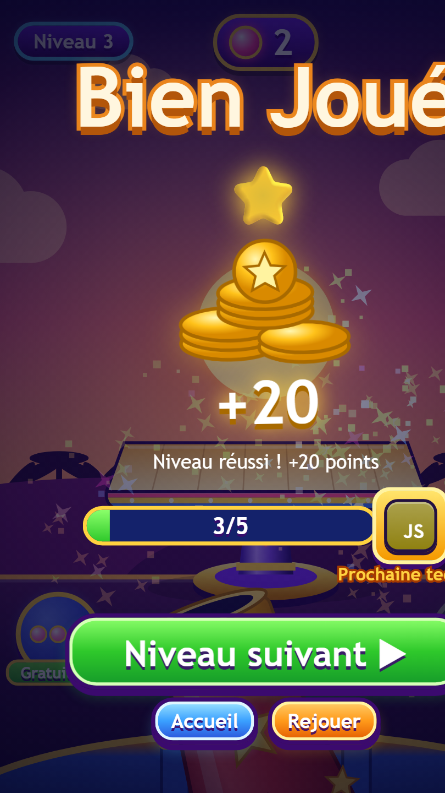
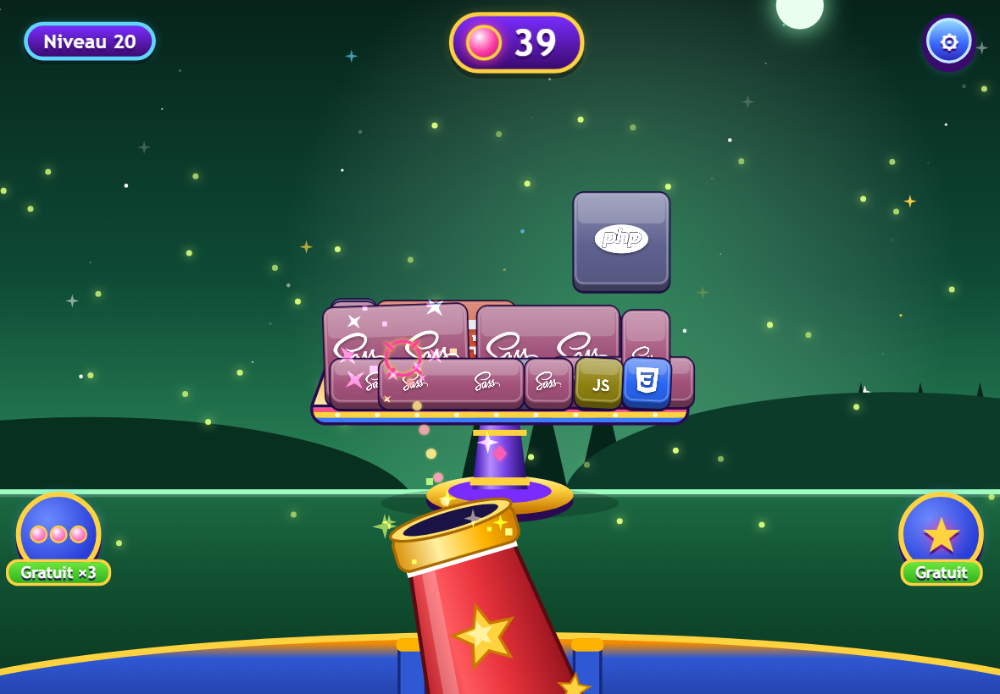

<div align="center">


# Princess Buster

**Fais tomber toutes les technos !** Un jeu de tir en 2.5D où tu fais exploser des piles de cubes de langages et frameworks de programmation, avec un nombre de balles limité.

[](https://github.com/princesse-aku/princess_buster/actions/workflows/ci.yml)
[](LICENSE)


[](CONTRIBUTING.md)

[Français](README.md) · [English](README.en.md)

</div>

<p align="center">
  
</p>

<p align="center">
  
  
  
  
</p>

## Sommaire

- [Le jeu](#le-jeu)
- [Captures d'écran](#captures-décran)
- [Fonctionnalités](#fonctionnalités)
- [Démarrage rapide](#démarrage-rapide)
- [Contrôles](#contrôles)
- [Les 250 niveaux](#les-250-niveaux)
- [Créer ou modifier un niveau](#créer-ou-modifier-un-niveau)
- [Architecture du projet](#architecture-du-projet)
- [API et sauvegarde](#api-et-sauvegarde)
- [Raccourcis de développement](#raccourcis-de-développement)
- [Feuille de route](#feuille-de-route)
- [Contribuer](#contribuer)
- [Licence et crédits](#licence-et-crédits)

## Le jeu

Une pile de cubes (HTML, CSS, JavaScript, PHP, Laravel, Node.js, Docker…) est posée sur une table. Ton canon, fixe au bas de l'écran, tire des balles : chaque balle **pousse la pièce visée vers le fond**. Elle glisse sur le plateau puis **tombe derrière la table**.

- Tu **gagnes** quand il n'y a plus aucun cube sur la table. Chaque niveau gagné rapporte **20 points + 1 point par balle restante** (ex. 5 balles restantes = 20 + 5 = 25 points) (les étoiles, elles, récompensent les balles économisées).
- Tu **perds** quand tu n'as plus de balles alors qu'il reste des cubes.
- Les niveaux deviennent plus durs : pièces plus lourdes et plus grandes, et à partir du niveau 5 des **pièces cachées derrière d'autres pièces** (celle de devant, poussée, fait tomber celle de derrière en premier).

## Captures d'écran

| Accueil | Choix du niveau |
| :---: | :---: |
|  |  |

| Niveau 3 : formats variés | Niveau 12 : pièces cachées derrière |
| :---: | :---: |
|  |  |

| Écran « Bien Joué » |
| :---: |
|  |

Le jeu occupe tout l'écran : ici sur une tablette en mode paysage.

<p align="center"></p>

## Fonctionnalités

- 🎯 **250 niveaux** décrits dans des fichiers JSON, avec **50 technologies** (dont les logos des IA : ChatGPT, Claude, Gemini, Grok, Mistral…) introduites progressivement, HTML5 et CSS3 d'abord
- 🎨 **12 décors** qui changent à chaque niveau : prairie, nuit, coucher de soleil, neige, désert, océan, bonbons, forêt, espace, automne, volcan, néon
- 🧱 **Pièces de formats variés** : carrés, rectangles larges ou hauts, 2×2, 3×1, 3×2 (les grandes piles rapetissent pour tenir à l'écran)
- 🌌 **Profondeur simulée** : selon l'angle du tir et l'endroit touché, une pièce tombe **derrière la table, à gauche ou à droite** ; une rangée cachée derrière les autres
- ⚖️ **Déséquilibre** : une pièce dont le support a glissé peut basculer toute seule un peu plus tard
- 🔒 **Aucun cube suspendu dans le vide** : chaque pièce repose sur une autre ou sur la table (vérifié par `npm test`)
- 📱 **Plein écran adaptatif** : téléphone, tablette, ordinateur, en portrait comme en paysage (pas de cadre de téléphone dessiné)
- ☁️ **Connexion Google, progression dans le cloud et classement général** (débloqué au niveau 10) avec Firebase / Firestore (optionnel, voir [docs/FIREBASE.md](docs/FIREBASE.md))
- 💾 **Profils et scores en SQLite** : nom du joueur demandé au lancement, meilleurs scores, déblocage progressif, classement
- 🏠 **Parcours complet** : splash, conditions, **accueil** avec le niveau à jouer, fiche de niveau, paramètres (son, musique, vibration), profil avec avatars, écran « Bien Joué » et tutoriel du premier niveau
- 🎁 **Bonus** : **tir triple** (niveau 3) et **super balle** (niveau 10), un de chaque par niveau
- 🔊 **Musique de fond et bruitages** synthétisés en WebAudio (aucun fichier audio), avec boutons pour les couper
- ✨ Particules, combos (« Super ! », « INCROYABLE ! »), traînée de balle, vibration sur mobile
- 🧩 **0 dépendance npm** : Node.js et un navigateur suffisent (Matter.js est fourni dans `public/vendor/`)

## Télécharger et jouer

- ▶️ **Jouer en ligne** : <https://princess-buster.vercel.app/>
- 📱 **Installer comme une application (PWA)** : ouvre le jeu dans Chrome (Android) → menu ⋮ → **Installer l'application** ; sur iPhone (Safari) → Partager → **Sur l'écran d'accueil**. Pas d'APK à télécharger : le jeu s'ouvre en plein écran comme une vraie application.
- 🌐 **Navigateur** : [déploiement Vercel](docs/DEPLOY-VERCEL.md) (jouable sur téléphone, tablette et PC).
- 💻 **En local** : voir ci-dessous.

[](https://vercel.com/new/clone?repository-url=https%3A%2F%2Fgithub.com%2Fprincesse-aku%2Fprincess_buster)

## Démarrage rapide

Prérequis : [Node.js](https://nodejs.org) **22.5 ou plus** (pour le module `node:sqlite` intégré).

```bash
git clone https://github.com/princesse-aku/princess_buster.git
cd princess_buster
npm start
```

Ouvre ensuite <http://localhost:3000> (sur ton téléphone : `http://<ip-de-ton-pc>:3000` sur le même réseau).

```bash
npm test          # valide les 250 niveaux (formats, techs, thèmes, aucun cube suspendu)
npm run levels    # régénère les niveaux (attention : écrase les fichiers de public/levels)
```

> La base SQLite est créée automatiquement dans `data/princess-buster.db` (ignorée par git). Si le serveur n'est pas joignable, le jeu sauvegarde dans le navigateur (`localStorage`).

## Contrôles

| Action | Souris / tactile | Clavier |
| --- | --- | --- |
| Viser | Glisser (le réticule suit ton doigt) | `←` `→` (ou `A` `D`) |
| Tirer | Relâcher | `Espace` ou `Entrée` |
| Annuler un tir | Ramener le doigt vers le canon avant de relâcher | — |
| Plein écran | Bouton ⛶ | — |

## Les 250 niveaux

- **Une nouvelle technologie tous les 5 niveaux** : les 5 niveaux d'un palier n'utilisent que les technologies déjà débloquées. Le **coffre de récompense** affiché pendant le palier montre la **prochaine technologie** ; en gagnant le 5ᵉ niveau tu la débloques (barre de progression 5/5), puis elle apparaît dans les 5 niveaux suivants.
- **Progression pas à pas** : les niveaux 1 à 5 n'utilisent que **HTML5 et CSS3**. Après chaque palier de 5 niveaux, une technologie s'ajoute : JavaScript (niveau 6), PHP (niveau 11), puis Sass, Bootstrap, TypeScript, jQuery, Tailwind CSS, Laravel, Node.js, Express, React, Vue.js, Angular, Python, Django, MySQL, MongoDB, Docker, Git, les **IA** (ChatGPT, Claude, Gemini, Grok, Mistral AI, Perplexity, Hugging Face, GitHub Copilot, Ollama, Llama), puis Go, Rust, Kotlin, Swift, Java, C#, C++, Ruby, Flutter et Dart. Les **50 technologies** sont toutes débloquées au niveau 240 (Bash en dernier).
- **Décors** : 12 thèmes qui tournent à chaque niveau (`meadow`, `night`, `sunset`, `snow`, `desert`, `ocean`, `candy`, `forest`, `space`, `autumn`, `volcano`, `neon`), définis dans `public/js/game.js`.
- **Difficulté** : piles plus grandes (jusqu'à 9×8), pièces plus lourdes et plus grandes, une rangée cachée derrière la rangée de devant sur certains niveaux (à partir du niveau 9).

## Créer ou modifier un niveau

Un niveau est un fichier `public/levels/levelNNN.json` :

```json
{
  "id": 3,
  "name": "Niveau 3",
  "theme": "sunset",
  "block": 0,
  "reward": null,
  "balls": 15,
  "cubeWeight": 1.15,
  "techs": ["html5", "css3", "sass", "bootstrap"],
  "rows": 3,
  "cols": 3,
  "pieces": [
    {"tech":"html5","col":0,"row":2,"w":2,"h":1,"layer":0},
    {"tech":"bootstrap","col":2,"row":2,"w":1,"h":1,"layer":0},
    {"tech":"css3","col":0,"row":1,"w":1,"h":1,"layer":0},
    {"tech":"sass","col":0,"row":1,"w":1,"h":2,"layer":1}
  ]
}
```

| Champ | Rôle |
| --- | --- |
| `theme` | Décor du niveau (un des 12 thèmes) |
| `block` | Numéro du palier de 5 niveaux (0 = niveaux 1 à 5) |
| `reward` | Clé de la techno débloquée à la fin du niveau (5ᵉ de chaque palier), sinon `null` |
| `balls` | Nombre de balles disponibles |
| `cubeWeight` | Multiplicateur de poids des pièces (plus c'est lourd, plus il faut de tirs) |
| `rows` / `cols` | Taille de la grille (la ligne `0` est en haut) |
| `pieces[].col/row` | Coin supérieur gauche de la pièce dans la grille |
| `pieces[].w/h` | Taille en cases (1×1, 2×1, 1×2, 2×2…) |
| `pieces[].layer` | `0` = devant, `1` et `2` = rangées de plus en plus profondes |
| `pieces[].tech` | Clé d'une techno de `public/levels/index.json` |

**Règles** (vérifiées par `npm test`) : pas de chevauchement dans une même rangée, tout dans la grille, et **chaque pièce doit reposer sur une pièce de la même rangée ou sur la table**. Le détail est dans [CONTRIBUTING.md](CONTRIBUTING.md#ajouter-ou-modifier-un-niveau).

## Architecture du projet

```
princess_buster/
├── public/                  # le jeu (statique, prêt pour Tauri)
│   ├── index.html
│   ├── css/style.css        # charte graphique (variables CSS issues du logo)
│   ├── js/
│   │   ├── game.js          # moteur : physique Matter.js, profondeur, rendu canvas, canon
│   │   ├── ui.js            # écrans, navigation, entrées (souris/tactile/clavier), plein écran
│   │   ├── audio.js         # musique + bruitages synthétisés (WebAudio)
│   │   └── storage.js       # sauvegarde : API SQLite avec repli localStorage
│   ├── levels/              # index.json + level001..250.json
│   ├── assets/              # logo.png + tech/*.svg (50 logos de technologies et d'IA)
│   └── vendor/matter.min.js
├── server/server.js         # serveur de test : fichiers statiques + API SQLite (node:sqlite)
├── tools/
│   ├── generate-levels.js   # générateur de niveaux (formes, pièces, difficulté)
│   └── validate-levels.js   # validateur utilisé par `npm test` et la CI
├── docs/screenshots/        # captures du README
└── .github/                 # CI, modèles d'issues et de pull requests
```

**Comment ça marche, en bref** : le moteur reste en 2D (Matter.js) pour l'empilement et les chutes sur les côtés. La profondeur est simulée par un axe `z` propre à chaque pièce : une balle ajoute de la vitesse en `z` (divisée par la masse), la pièce glisse sur le dessus du plateau, puis tombe derrière si elle dépasse la profondeur de la table. Une pièce poussée qui rencontre une pièce « derrière » lui transmet son élan.

## API et sauvegarde

Base SQLite (`data/princess-buster.db`), deux tables : `players` (nom unique) et `progress` (meilleur score, tentatives, niveau réussi ; 20 points + balles restantes par niveau gagné).

| Méthode | Route | Rôle |
| --- | --- | --- |
| `POST` | `/api/player` | Crée ou retrouve un joueur `{ name }` et renvoie sa progression |
| `POST` | `/api/progress` | Enregistre un résultat `{ playerId, level, score, won }` |
| `GET` | `/api/leaderboard` | Top 10 des joueurs |

## Raccourcis de développement

```text
http://localhost:3000/?name=Ada                       → connexion directe, menu des niveaux
http://localhost:3000/?name=Ada&level=12              → lance directement le niveau 12
http://localhost:3000/?name=Ada&level=12&autoplay=1   → un petit robot joue (démo, captures)
http://localhost:3000/?name=Ada&level=12&autoplay=1&clean=1   → idem sans bandeau ni texte d'aide
```

## Feuille de route

- [ ] Application **desktop avec [Tauri](https://tauri.app)** (optionnel : l'installation PWA suffit sur mobile) (`public/` est déjà le `frontendDist` ; `storage.js` à brancher sur `tauri-plugin-sql`, mêmes tables)
- [ ] Pièces spéciales (explosives, indestructibles, rebondissantes)
- [ ] Bonus achetables (triple tir, bombe…)
- [ ] Plus de niveaux et de technologies (Go, Rust, Kotlin, Swift…)
- [ ] Traductions (le jeu est en français)
- [ ] Éditeur de niveaux visuel

Une idée ? Ouvre une [issue](https://github.com/princesse-aku/princess_buster/issues/new/choose).

## Contribuer

Les contributions sont les bienvenues : bugs, niveaux, technologies, traductions, accessibilité, documentation…
Lis le [guide de contribution](CONTRIBUTING.md) et le [code de conduite](CODE_OF_CONDUCT.md). Pour une faille de sécurité, voir [SECURITY.md](SECURITY.md).

## Licence et crédits

- Code : [licence MIT](LICENSE) © 2026 princesse-aku
- Le **logo « Princess Buster »** (`public/assets/logo.png`) n'est **pas** couvert par la licence MIT : tous droits réservés à l'auteur du projet
- Les **avatars** (`public/assets/avatars/`) sont des illustrations de l'auteur du projet : tous droits réservés, non couverts par la licence MIT
- Logos des technologies : [Devicon](https://devicon.dev) (MIT) et logos d'IA : [Simple Icons](https://simpleicons.org) (CC0) ; le logo de Grok est un dessin original évoquant la marque. Les marques appartiennent à leurs propriétaires respectifs
- Physique : [Matter.js](https://brm.io/matter-js/) (MIT)
- Inspiration de gameplay : les jeux de tir de cubes en piles pour mobile. Aucun asset de ces jeux n'est utilisé ici
